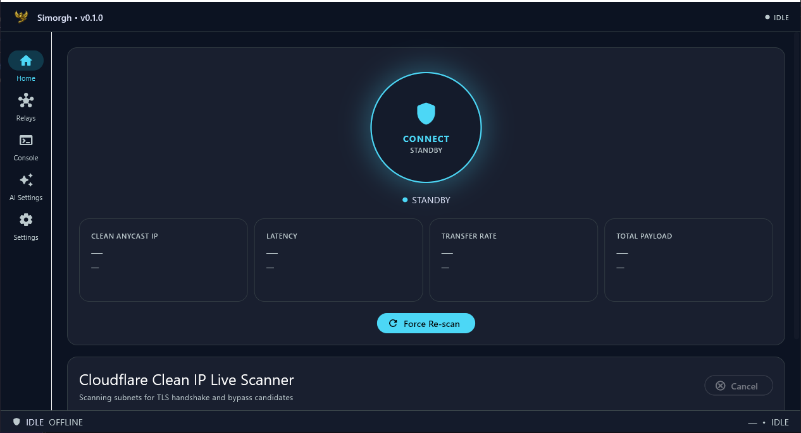
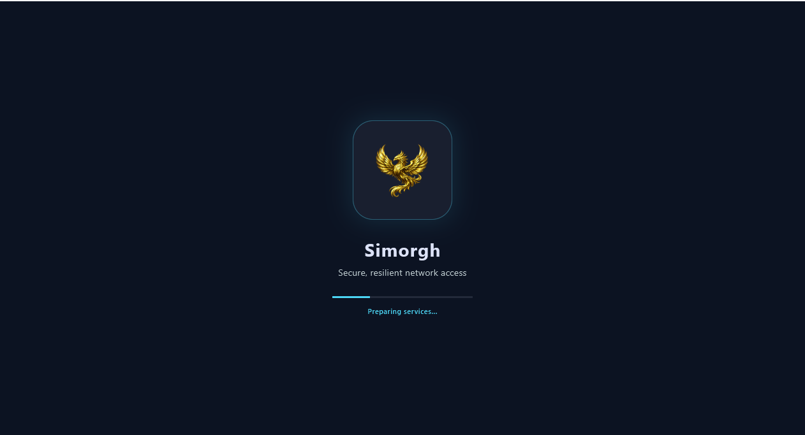
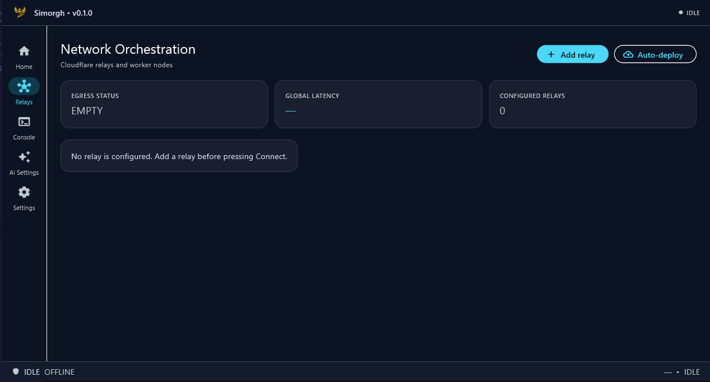
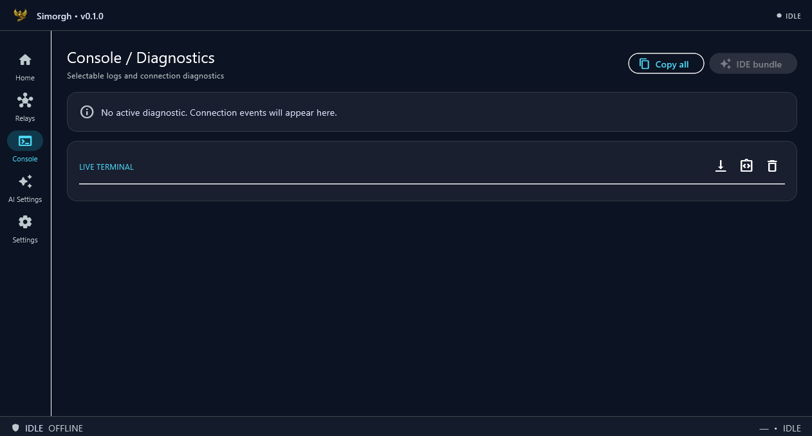
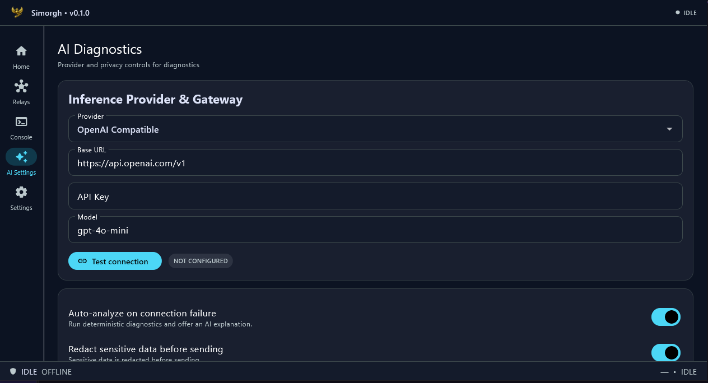
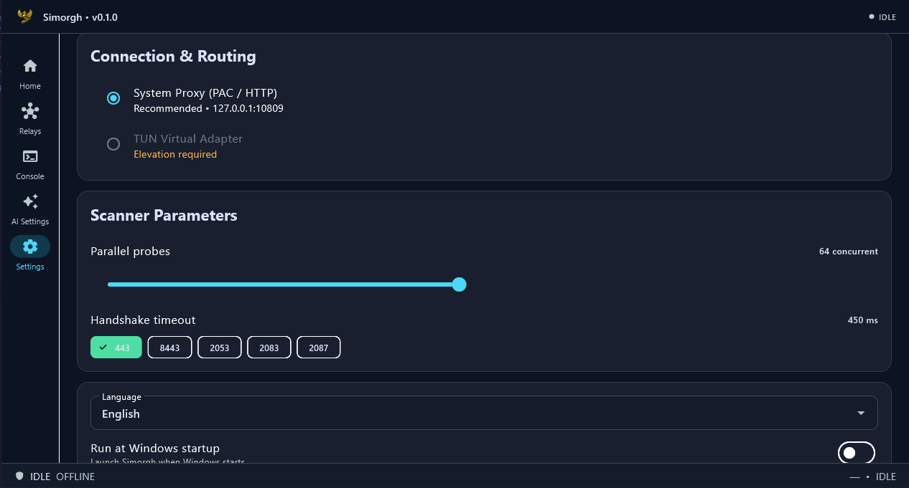

# Simorgh

[](https://github.com) [](https://github.com) [](https://github.com)

Simorgh is a Windows-focused Flutter desktop client for a privacy-first Cloudflare relay workflow. The production composition root connects Home to secure storage, relay persistence, the real scanner, sing-box lifecycle, health checks and Windows proxy cleanup. A no-services `SimorghApp()` remains available for widget previews.

## Features

- Dark desktop shell with navigation rail.
- Home flow: Idle → Scanning → Connecting → Connected, plus a simulated failure state.
- Live IP scan events, progress, telemetry and stage chips when an active relay and verified core are configured, plus a real TCP/TLS scanner service.
- Relay overview, selectable diagnostic console, AI settings and routing settings.
- Secure secrets, rotating JSONL logs, sing-box config/process lifecycle, Cloudflare Worker deployment, health checks, fallback config updates and auto-reconnect policy.
- English, Persian (default), and Hindi localization. Persian uses RTL; Hindi and English use LTR.

## Screenshots

<p align="center">
  
  
  
  
  
  
</p>

A verified `sing-box.exe`, relay configuration, user credentials and explicit Windows
permissions are required before using the real path. TUN/Wintun and a signed core
distribution are not bundled in this repository. The current real mode uses the Windows
system proxy and restores it on disconnect, failure and tray exit.

## Requirements

- Flutter stable **3.47.5**, pinned in `.fvmrc`.
- Windows desktop tooling for the Windows release: Visual Studio Desktop development
  with C++, MSVC x64/x86 build tools, a Windows SDK and CMake tools. The secure
  storage plugin uses Windows DPAPI and does not require the optional ATL headers.

## Setup

```powershell
flutter pub get
```

## Run

```powershell
flutter run -d windows
```

Use Relays → Add relay to store a relay hostname, port, UUID and WebSocket path securely.
Mark one relay active, place the verified core binary and its 64-character hash manifest
in the application-support core directory, then press Connect. Home subscribes to real
session events; Cancel/Disconnect stops scanning, sing-box and the system proxy.

For automatic relay creation, open **Relays → Auto-deploy** and enter a Cloudflare API
token, account ID, relay name and Worker script name. The app verifies the token, reads
the account's `workers.dev` subdomain, uploads the bundled VLESS-over-WebSocket Worker,
generates the UUID and path, saves the relay with the full Worker hostname, and marks
the first relay active. The token and account ID are stored through the platform secure
store; they are never written to relay metadata or logs. The token needs permission to
edit Workers Scripts for the selected account, and the account must have a `workers.dev`
subdomain available. The Worker name must contain only letters, numbers and dashes and
must not start or end with a dash.

The app now installs the bundled signed-by-hash Windows core on first launch.
The resolver expects these files below the Windows application-support directory:

```text
data/core/sing-box.exe
data/core/sing-box.sha256
```

## Creating a Cloudflare Worker: Complete User Guide

### Recommended Method: Automatic Deployment from Simorgh

If you only want to get the application running, you do not need to copy the Worker code:

1. In Cloudflare, create an API Token with **Workers Scripts: Edit** permission for the desired account.
2. Ensure your account has an active `workers.dev` subdomain.
3. In Simorgh, go to **Relays → Auto-deploy**.
4. Enter the Relay name, Worker name, Account ID, and API Token.
5. Click **Deploy**.

Simorgh verifies the token, reads the actual subdomain of your account, uploads the bundled VLESS-over-WebSocket Worker, generates random UUID and WebSocket path, saves the relay with the full Worker hostname, and marks it as active if it's the first relay. With this method, do not manually paste the code below in Cloudflare.

### Manual Method: Copying Worker Code

Use this method when you want to create the Worker yourself in Cloudflare or review its code. This guide is written for the Cloudflare Dashboard, and some button names may vary slightly across different versions.

#### Step 1: Log in to Cloudflare

1. Go to the [Cloudflare Dashboard](https://dash.cloudflare.com/).
2. Select the desired account.
3. From the **Workers & Pages** menu, go to the Workers section.
4. If you don't have a subdomain yet, in the **Workers & Pages** section, select **Change** next to **Your subdomain** and create a subdomain for your account.

#### Step 2: Create Worker

1. Click **Create application** or **Create Worker**.
2. Enter the Worker name; for example:

   ```text
   simorgh-relay
   ```

   The name must only contain English letters, numbers, and `-`, have a maximum of 63 characters, and must not start or end with a dash.
3. Click **Deploy** to create the initial Worker.
4. Open the created Worker and go to **Edit code**.

#### Step 3: Create Secret Values

The Worker requires two values to accept connections: a UUID and a WebSocket path. Create these values yourself and do not share them with others.

In PowerShell, you can generate a UUID:

```powershell
[guid]::NewGuid().Guid
```

To get started, select a path like the following example:

```text
/simorgh-demo-7f3a
```

The path must start with `/` and must be exactly the same in the Worker code and Relay settings in Simorgh. The examples below are just samples; for actual use, create your own UUID and path.

#### Step 4: Complete Worker Code

Delete all the code in the Cloudflare editor and paste the following complete code. Then replace the `EXPECTED_UUID` and `EXPECTED_PATH` values with your own:

```javascript
import { connect } from "cloudflare:sockets";

// These two values must exactly match the Relay in Simorgh.
const EXPECTED_UUID = "8f4d6f2a-4b2c-4e6a-9d31-7c1b6a8e2190";
const EXPECTED_PATH = "/simorgh-demo-7f3a";

export default {
  async fetch(request) {
    const url = new URL(request.url);

    // For checking Worker health.
    if (url.pathname === "/health") {
      return new Response("simorgh-relay-ok", { status: 200 });
    }

    // Only the secret Relay path is allowed.
    if (url.pathname !== EXPECTED_PATH) {
      return new Response("Not found", { status: 404 });
    }

    // Relay connection must be WebSocket.
    if (request.headers.get("Upgrade") !== "websocket") {
      return new Response("WebSocket upgrade required", { status: 426 });
    }

    const [client, server] = Object.values(new WebSocketPair());
    server.accept();

    handleVlessSession(server).catch(() => {
      try {
        server.close(1011, "relay failure");
      } catch (_) {}
    });

    return new Response(null, {
      status: 101,
      webSocket: client,
    });
  },
};

async function handleVlessSession(webSocket) {
  let remote;
  let writer;
  let initialized = false;

  webSocket.addEventListener("message", async (event) => {
    const bytes = await asBytes(event.data);

    if (!initialized) {
      const request = parseVlessRequest(bytes);

      if (
        !request ||
        request.uuid !== normalizeUuid(EXPECTED_UUID) ||
        request.command !== 1
      ) {
        webSocket.close(1008, "invalid request");
        return;
      }

      remote = connect({
        hostname: request.host,
        port: request.port,
      });

      writer = remote.writable.getWriter();
      initialized = true;

      // Initial VLESS response.
      webSocket.send(new Uint8Array([0, 0]));

      if (request.payload.byteLength > 0) {
        await writer.write(request.payload);
      }

      pumpRemote(remote, webSocket);
      return;
    }

    if (writer) {
      await writer.write(bytes);
    }
  });

  webSocket.addEventListener("close", async () => {
    try {
      if (writer) await writer.close();
    } catch (_) {}

    try {
      if (remote) remote.close();
    } catch (_) {}
  });
}

async function pumpRemote(remote, webSocket) {
  const reader = remote.readable.getReader();

  try {
    while (true) {
      const next = await reader.read();

      if (next.done) {
        break;
      }

      webSocket.send(next.value);
    }
  } finally {
    try {
      reader.releaseLock();
    } catch (_) {}

    try {
      webSocket.close(1000, "upstream closed");
    } catch (_) {}
  }
}

function parseVlessRequest(bytes) {
  // Minimum VLESS header size required.
  if (bytes.byteLength < 24 || bytes[0] !== 1) {
    return null;
  }

  const uuid = toHex(bytes.slice(1, 17));
  const addonLength = bytes[17];
  let offset = 18 + addonLength;

  if (offset + 4 > bytes.byteLength) {
    return null;
  }

  const command = bytes[offset++];
  const port = (bytes[offset] << 8) | bytes[offset + 1];
  offset += 2;
  const addressType = bytes[offset++];
  let host;

  // IPv4.
  if (addressType === 1) {
    if (offset + 4 > bytes.byteLength) {
      return null;
    }

    host = Array.from(bytes.slice(offset, offset + 4)).join(".");
    offset += 4;
  }

  // Domain name.
  else if (addressType === 2) {
    const length = bytes[offset++];

    if (offset + length > bytes.byteLength) {
      return null;
    }

    host = new TextDecoder().decode(bytes.slice(offset, offset + length));
    offset += length;
  }

  // IPv6.
  else if (addressType === 3) {
    if (offset + 16 > bytes.byteLength) {
      return null;
    }

    const parts = [];

    for (let i = 0; i < 16; i += 2) {
      parts.push(
        ((bytes[offset + i] << 8) | bytes[offset + i + 1]).toString(16),
      );
    }

    host = parts.join(":");
    offset += 16;
  } else {
    return null;
  }

  return {
    uuid,
    command,
    port,
    host,
    payload: bytes.slice(offset),
  };
}

function normalizeUuid(value) {
  return value.replaceAll("-", "").toLowerCase();
}

function toHex(bytes) {
  return Array.from(bytes)
    .map((value) => value.toString(16).padStart(2, "0"))
    .join("");
}

async function asBytes(value) {
  if (value instanceof ArrayBuffer) {
    return new Uint8Array(value);
  }

  if (ArrayBuffer.isView(value)) {
    return new Uint8Array(value.buffer, value.byteOffset, value.byteLength);
  }

  return new TextEncoder().encode(String(value));
}
```

#### Step 5: Publish Worker

1. In the Cloudflare editor, make sure the following two values are replaced:

   ```javascript
   const EXPECTED_UUID = "YOUR-UUID";
   const EXPECTED_PATH = "/YOUR-PATH";
   ```

2. Click **Save and deploy** or **Deploy**.
3. Wait a few moments for the Worker status to change to **Deployed**.
4. In the Worker settings, verify that the `workers.dev` route is enabled.

The public Worker address usually looks like this:

```text
<worker-name>.<account-subdomain>.workers.dev
```

For example:

```text
simorgh-relay.myaccount.workers.dev
```

#### Step 6: Test Worker

In a browser or PowerShell, open the health address:

```powershell
Invoke-WebRequest `
  -Uri "https://<worker-name>.<account-subdomain>.workers.dev/health" `
  -UseBasicParsing
```

The correct response should be:

```text
simorgh-relay-ok
```

If you get a `404` response, check the `/health` path exactly. If you get a DNS error, the `workers.dev` subdomain or Worker name may not be ready yet. If the code does not deploy, check the Worker name and account access.

#### Step 7: Add Relay in Simorgh

In the app, go to **Relays → Add relay** and enter the following values:

| Simorgh Field | Value |
| --- | --- |
| Name | Any name, such as `Cloudflare Relay` |
| Hostname | Without `https://`; such as `simorgh-relay.myaccount.workers.dev` |
| Port | `443` |
| UUID | Same value as `EXPECTED_UUID` in Worker |
| WebSocket path | Same value as `EXPECTED_PATH` in Worker, such as `/simorgh-demo-7f3a` |

Save the Relay, mark it as **Active**, and then start the connection from the Home page.

UUID, path, API Token, and Account ID are sensitive information. Do not place them in Git, issues, logs, or public messages. If you use **Auto-deploy**, the manual method and code above are not required; Simorgh generates secure random values and stores them in secure storage.

## Checks

On Windows PowerShell, run the commands directly:

```powershell
flutter analyze
flutter test
```

On Linux/macOS with GNU Make, the equivalent shortcuts are:

```bash
make analyze
make test
```

After `flutter pub get`, tests and analysis are offline-friendly. The Dockerfile pins the same Flutter version for reproducible CI.

Secure values use the `get_x_storage_secure` plugin from the public Git repository.
On Windows it stores user-scoped DPAPI blobs and does not require the ATL headers
used by the removed ATL-dependent plugin. The Git dependency is
locked to its resolved commit in `pubspec.lock`.

## Build

```powershell
flutter build windows --release
```

The release output is under `build/windows/x64/runner/Release/`.

For a repeatable Windows build with checks and a SHA-256 manifest:

```powershell
powershell -ExecutionPolicy Bypass -File .\scripts\build_windows.ps1
```

The optional Inno Setup definition is `installer/Simorgh.iss`. Open it with
Inno Setup 6 after the release build to create a per-user installer under
`installer/Output/`. A portable distribution is the complete contents of
`build/windows/x64/runner/Release/`, including `SHA256SUMS.txt`.

## Security

Never put Cloudflare tokens, AI keys, UUIDs or private configuration in this repository. Store credentials through `get_x_storage_secure`/Windows DPAPI, use the redacted `LogService`, verify a core SHA-256 before launch, and review all AI payloads before sending them. `.env.example` contains placeholders only.
